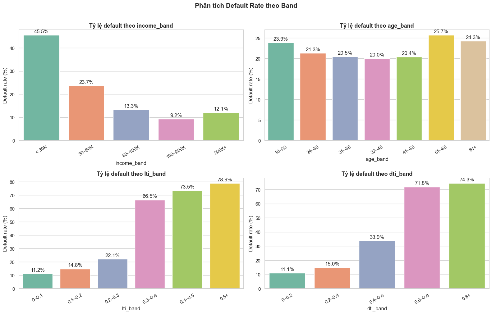
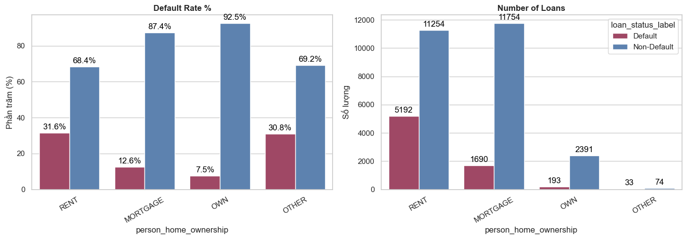
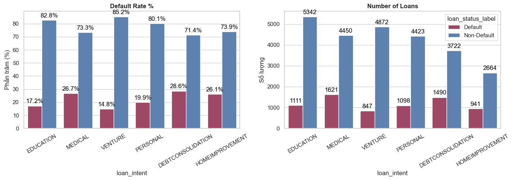
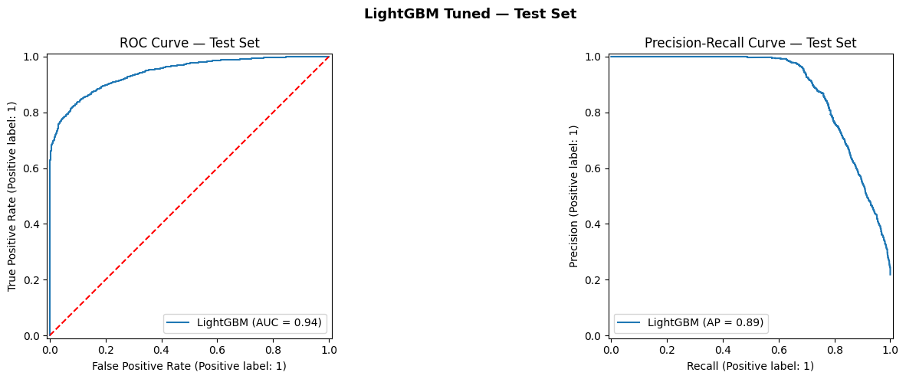
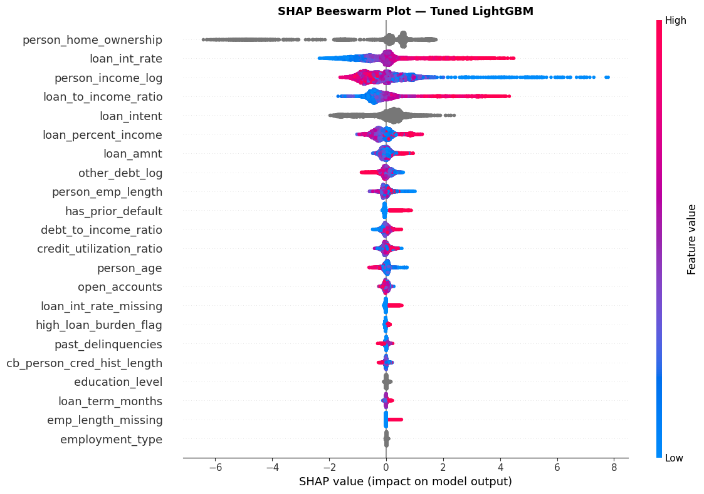

# Phân tích rủi ro tín dụng — Credit Risk Analysis & Intelligent Loan Decisioning System

> Phân tích danh mục, xây dựng mô hình dự đoán default và hệ thống hỗ trợ phân luồng hồ sơ vay.
> 🌐 **Demo**: [NovaBank Credit Risk](https://credit-risk-prediction-pi.vercel.app/en/apply)
> 🛠️ **Tech Stack**: Python · SQL Server · Scikit-learn · LightGBM · Optuna · SHAP · Power BI · FastAPI · Next.js · PostgreSQL

Dự án kết nối **phân tích dữ liệu, mô hình học máy và ứng dụng chấm điểm tín dụng**: khám phá dữ liệu hồ sơ vay, thiết kế đặc trưng, so sánh mô hình, phân tích sai số và chuyển kết quả thành điểm tín dụng nội bộ cùng các quy tắc phân luồng. Notebook lưu quá trình thực nghiệm; ứng dụng web sử dụng pipeline đã xuất để chấm điểm từng hồ sơ.

---

## 1. Bối Cảnh Nghiệp Vụ & Mục Tiêu Dự Án

### 1.1 Bài toán nghiệp vụ

Thẩm định tín dụng cần cân bằng giữa **phát hiện khách hàng có nguy cơ default** và **hạn chế loại nhầm khách hàng có khả năng trả nợ**. Ba khó khăn cần giải quyết là thời gian xử lý thủ công, tính thiếu nhất quán giữa người thẩm định và sự hạn chế của các quy tắc đạt/trượt cố định.

Mục tiêu dự án là xây dựng một quy trình hỗ trợ quyết định có thể dự đoán rủi ro, phân luồng hồ sơ và cung cấp thông tin giải thích để người thẩm định xem xét.

### 1.2 Giải pháp & Giá trị hướng tới

| Đối tượng | Giá trị hướng tới |
|---|---|
| **Quản trị rủi ro** | Nhận diện các phân khúc có tỷ lệ default cao và hỗ trợ xây dựng chính sách. |
| **Vận hành tín dụng** | Hỗ trợ phân luồng `APPROVE / REVIEW / REJECT`, kèm cảnh báo theo hồ sơ. |
| **Quản lý** | Theo dõi đặc điểm danh mục qua báo cáo Power BI. |
| **Phát triển sản phẩm** | Khai thác khác biệt giữa các nhóm khách hàng và mục đích vay. |

Kết quả phân tích và kiểm thử trong README mô tả bộ dữ liệu của dự án; lợi ích về thời gian xử lý, doanh thu và tổn thất tín dụng chưa được đo lường bằng một thử nghiệm vận hành thực tế.

---

## 2. Phân Tích Khám Phá Dữ Liệu — EDA & Các Phát Hiện Chính

Trước khi xây dựng mô hình, dự án thực hiện **Exploratory Data Analysis (EDA)** để hiểu cấu trúc dữ liệu, phát hiện vấn đề chất lượng và tìm những yếu tố có liên hệ với trạng thái default. Quá trình gồm thống kê mô tả, kiểm tra thiếu/trùng lặp/ngoại lệ, trực quan hóa phân phối, phân tích tương quan và đối chiếu tỷ lệ default giữa các nhóm khách hàng.

Các kết quả dưới đây định hướng cho thiết kế đặc trưng và khung chính sách. Toàn bộ bước khám phá nằm trong [data_understanding.ipynb](notebooks/data_understanding.ipynb) và [EDA.ipynb](notebooks/EDA.ipynb). Các mối liên hệ quan sát được là bằng chứng mô tả; những giải thích về dòng tiền hoặc hành vi khách hàng là giả thuyết nghiệp vụ, chưa phải kết luận nhân quả.

### 2.1 Dữ liệu & Phạm vi phân tích

| Nội dung | Thông tin |
|---|---|
| **Dữ liệu đầu vào** | 32.581 dòng, 29 cột trong [CSV của dự án](raw_data/Credit%20Risk%20Dataset.xlsx%20-%20Credit%20Risk%20Data.csv). Mỗi dòng là một hồ sơ có `client_ID` riêng. |
| **Dữ liệu qua SQL** | EDA và huấn luyện đọc `dbo.vw_credit_risk_base` trên SQL Server: output EDA ghi nhận 32.581 dòng, 33 cột, gồm thêm cờ thiếu và nhãn mô tả. |
| **Biến mục tiêu** | `loan_status`: `0 = Non-default`, `1 = Default`, theo [data dictionary](raw_data/Credit%20Risk%20Dataset.xlsx%20-%20Data%20Dictionary.csv). |
| **Phân bố nhãn** | Non-default: **25.473 (78,18%)**; default: **7.108 (21,82%)**. |
| **Các nhóm thông tin** | Cá nhân, tài chính, khoản vay, lịch sử tín dụng và địa lý. |

Data dictionary xác định `other_debt` là **dữ liệu nợ bổ sung được mô phỏng**. Tài liệu trong repository chưa xác nhận đầy đủ nguồn thu thập của từng trường hoặc cửa sổ thời gian định nghĩa default; vì vậy nhãn 1 không được tự diễn giải thành một chuẩn nợ quá hạn cụ thể. Các giá trị `USA / UK / Canada` là phân nhóm trong dữ liệu, chưa đủ chứng minh tính đại diện cho ba thị trường thực tế.

### 2.2 Quy trình khám phá & Chất lượng dữ liệu

EDA được triển khai theo bốn bước: **kiểm tra cấu trúc → khảo sát phân phối → đối chiếu với nhãn → tổng hợp quan hệ giữa các biến**. Histogram, boxplot, biểu đồ tỷ lệ theo nhóm và heatmap tương quan được dùng để chọn các vấn đề cần xử lý trước huấn luyện.

| Kiểm tra | Kết quả quan sát | Hàm ý |
|---|---|---|
| Thiếu `person_emp_length` | **895 dòng (2,75%)** | Cần điền thiếu và xem xét giữ lại tín hiệu missing. |
| Thiếu `loan_int_rate` | **3.116 dòng (9,56%)** | Cần phương án xử lý khi hồ sơ không có lãi suất. |
| Trùng lặp | **0 dòng trùng toàn bộ; 0 `client_ID` trùng** trong output kiểm tra | Không có bước loại dòng trùng trong quy trình được mô tả. |
| Tuổi và thâm niên bất thường | 7 dòng tuổi >80; 2 dòng thâm niên >60; có giá trị tối đa 144 tuổi và 123 năm làm việc | Phân biệt giá trị bất hợp lý với ngoại lệ tài chính có thể hợp lệ. |
| DTI vượt 1 | **4 dòng** | Cần mô tả rõ cách giới hạn giá trị ở bước mô hình. |
| Phân phối biến tiền tệ | Thu nhập và nợ khác lệch phải mạnh | Xem xét biến đổi log; không mặc định mọi giá trị lớn đều là lỗi. |

Trong EDA, nhóm thiếu thâm niên có tỷ lệ default **31,51%**, còn nhóm thiếu lãi suất là **20,67%**. Đây là cơ sở để thử giữ missing flags; chưa chứng minh riêng các cờ này cải thiện mô hình. Cách xử lý cụ thể nằm ở mục 4.2.

### 2.3 Những phát hiện chính về rủi ro

**Khả năng tài chính và gánh nặng khoản vay.** Dữ liệu được chia band bằng `pd.cut`, với biên phải được bao gồm. Ví dụ `(0,30; 0,40]` nghĩa là lớn hơn 0,30 và không vượt 0,40.

| Chỉ số / Nhóm | Số hồ sơ | Số default | Tỷ lệ default |
|---|---:|---:|---:|
| LTI ≤0,10 | 9.886 | 1.108 | 11,21% |
| LTI (0,20; 0,30] | 6.348 | 1.402 | 22,09% |
| LTI (0,30; 0,40] | 2.835 | 1.885 | 66,49% |
| LTI >0,50 | 265 | 209 | 78,87% |
| DTI ≤0,20 | 4.109 | 455 | 11,07% |
| DTI (0,60; 0,80] | 1.236 | 888 | 71,84% |
| DTI >0,80 | 74 | 55 | 74,32% |



*Nguồn: biểu đồ đã lưu trong EDA.ipynb, cell phân tích default theo band. Số lượng và tỷ lệ trong bảng được đối chiếu lại từ CSV với cùng biên nhóm.*

Tỷ lệ default tăng rõ ở các band LTI/DTI cao. Theo thu nhập, nhóm ≤30.000 USD/năm ghi nhận **45,53%**, nhóm (100.000; 200.000] là **9,23%**, nhưng nhóm >200.000 tăng lại **12,08%**; xu hướng không giảm tuyệt đối. Các nhóm tuổi cũng không tạo thành một đường cong chữ U hoàn hảo. Với các band ít mẫu, cần đọc tỷ lệ cùng quy mô nhóm.

**Nhà ở và lịch sử tín dụng.**

| Phân nhóm | Số hồ sơ | Số default | Tỷ lệ default |
|---|---:|---:|---:|
| Thuê nhà — `RENT` | 16.446 | 5.192 | 31,57% |
| Đang trả góp nhà — `MORTGAGE` | 13.444 | 1.690 | 12,57% |
| Sở hữu nhà — `OWN` | 2.584 | 193 | 7,47% |
| Nhà ở khác — `OTHER` | 107 | 33 | 30,84% |
| Có lịch sử default — `Y` | 5.745 | 2.172 | 37,81% |
| Không có lịch sử default — `N` | 26.836 | 4.936 | 18,39% |



*Nguồn: EDA.ipynb, phân tích biến phân loại với nhãn; số liệu đối chiếu từ CSV.*

`RENT` có tỷ lệ default khoảng **4,2 lần** `OWN`; nhóm có lịch sử default cao khoảng **2,06 lần** nhóm không có. Các biến này cung cấp tín hiệu phân hóa để đưa vào mô hình; quyền sở hữu nhà không đồng nghĩa khoản vay đã có tài sản bảo đảm.

**Mục đích vay.**



*Nguồn: EDA.ipynb, phân tích `loan_intent` với nhãn; cột màu đỏ biểu diễn Default.*

Nhóm hợp nhất nợ có **1.490/5.212 hồ sơ default (28,59%)**, y tế **1.621/6.071 (26,70%)**, còn kinh doanh **847/5.719 (14,81%)**. Mục đích vay có mức phân hóa đáng chú ý, nhưng các tỷ lệ này chưa xác định tác động riêng của mục đích vay sau khi kiểm soát thu nhập và đòn bẩy.

**Các biến có mức phân hóa quan sát nhỏ hơn.** Theo loại việc làm, tỷ lệ default nằm trong khoảng **21,57–22,67%**; theo quốc gia là **21,73–21,86%**. Kết quả đơn biến chưa cung cấp bằng chứng mạnh để thiết lập chính sách riêng cho từng nhóm. Các phân tích sử dụng thẻ, số tài khoản và thâm niên tín dụng được giữ trong notebook để tránh diễn giải một mức chênh lệch nhỏ thành quy luật hành vi chắc chắn.

### 2.4 Hàm ý cho thiết kế mô hình

| Quan sát từ EDA | Lựa chọn trong mô hình hiện tại |
|---|---|
| Thu nhập và nợ khác lệch phải | Dùng `log1p` cho hai biến tiền tệ. |
| Hai trường có missing | Điền thiếu theo nhóm, kèm hai missing flags. |
| LTI/DTI phân hóa tỷ lệ default | Giữ các tỷ số và tạo cờ gánh nặng khoản vay. |
| Nhà ở, mục đích vay và lịch sử default phân hóa giữa các nhóm | Giữ các biến này, sau đó đối chiếu với SHAP và phân tích lỗi. |
| `loan_percent_income` và `loan_to_income_ratio` gần trùng thông tin | LR bỏ `loan_percent_income`; LightGBM hiện giữ cả hai. Chưa có ablation riêng để đo lợi ích của việc giữ đồng thời. |
| `loan_grade` phân hóa nhãn rất mạnh | Loại khỏi tập biến mô hình; cần xác minh thời điểm gán grade trước khi kết luận đây là target leakage. |

Từ các phát hiện này, mục 3 mô tả cách chuyển thành khung chính sách và mục 4 trình bày quy trình xây dựng mô hình.

---

## 3. Khung Chính Sách Tín Dụng & Quy Tắc Phân Luồng

Chính sách được chia theo năm nhóm thông tin. **Các quy tắc đã triển khai** được đối chiếu với [ml/scoring.py](App/BE/ml/scoring.py); **đề xuất nghiệp vụ** là hướng sử dụng kết quả phân tích, chưa phải chức năng tự động của ứng dụng.

### 3.1 Khả năng tài chính & Đòn bẩy

**Đã triển khai:** dùng LTI/DTI để chặn hoặc hạ luồng; cảnh báo thu nhập, khoản vay và nợ khác có giá trị lớn. Điều kiện cụ thể được tập trung tại mục 3.6.

Trong backend, `LTI = loan_amnt / person_income` và `DTI = (other_debt + loan_amnt) / person_income`, với thu nhập năm và mẫu số tối thiểu 1. Đây là tỷ số tổng số dư nợ trên thu nhập năm theo cách tính của dự án, không phải tỷ lệ nghĩa vụ trả nợ hàng tháng. **Đề xuất nghiệp vụ:** bổ sung thông tin dòng tiền trả nợ thực tế khi đánh giá khả năng chi trả.

### 3.2 Lịch sử tín dụng & Thanh toán

**Đã triển khai:** số lần quá hạn có thể chặn hoặc hạ luồng; lịch sử default sinh mã `PRIOR_DEFAULT`. Riêng tiền sử default không phải điều kiện bắt buộc của quy tắc chặn khi quá hạn ≥5 lần.

**Đề xuất nghiệp vụ:** đối soát thông tin quá hạn và lịch sử tín dụng khi chuyên viên thẩm định. Ứng dụng chưa có cơ chế cộng điểm cố định hoặc ưu đãi lãi suất cho một band sử dụng thẻ.

### 3.3 Hình thức nhà ở

**Đã triển khai:** nhà ở là đặc trưng của mô hình và tạo mã giải thích theo nhóm `RENT`/`OWN`.

**Đề xuất nghiệp vụ:** xem xét thêm tài sản và chi phí nhà ở khi thẩm định. Chưa có quy tắc miễn từ chối cho `MORTGAGE`; các mã có từ “collateral” trong code là nhãn gợi ý, không xác nhận tài sản thế chấp thực tế.

### 3.4 Mục đích sử dụng vốn

**Đã triển khai:** mục đích vay là đặc trưng mô hình và sinh mã `RISKY_LOAN_PURPOSE` hoặc `GOOD_LOAN_PURPOSE` theo nhóm đã cấu hình.

**Đề xuất nghiệp vụ:** dùng mục đích vay để định hướng kiểm tra chứng từ. Các mức cộng/trừ lãi suất chưa được triển khai trong logic hiện tại.

### 3.5 Đặc điểm khách hàng

**Đã triển khai:** tuổi, loại việc làm và học vấn có trong tập đặc trưng. Quốc gia và các trường địa lý không nằm trong tập biến mô hình hiện tại.

**Đề xuất nghiệp vụ:** kiểm tra tính phù hợp và hiệu năng theo phân khúc trước khi bổ sung chính sách riêng; ứng dụng chưa có quy tắc giới hạn kỳ hạn theo tuổi hoặc điều chỉnh theo quốc gia.

### 3.6 Ma trận quy tắc đã triển khai

| Tầng | Điều kiện | Hành động |
|---|---|---|
| **Knock-out** | Quá hạn **≥5 lần**, **hoặc** LTI **≥0,80**, **hoặc** DTI **≥0,60** | Trả `REJECT`, risk `high`; điểm cuối là `min(điểm mô hình, 500)`. |
| **Soft downgrade** | Quá hạn **≥3 lần**, **hoặc** LTI **≥0,30**, **hoặc** DTI **≥0,40** | Nếu luồng ban đầu là `low`, chuyển sang `medium / REVIEW`; giữ nguyên điểm. |
| **Cờ giá trị lớn** | Thu nhập **>150.000 USD/năm**, khoản vay **>25.000 USD**, hoặc nợ khác **>30.000 USD** | Sinh cảnh báo theo từng điều kiện; bản thân các cờ này không đổi điểm hoặc quyết định. |

Knock-out được xét trước soft downgrade. Các quy tắc áp dụng sau dự đoán; kết quả mô hình độc lập trong mục 5 chưa bao gồm tác động của lớp chính sách này.

---

## 4. Xử Lý Dữ Liệu, Huấn Luyện Mô Hình & Chấm Điểm Tín Dụng

Quy trình thực nghiệm được lưu trong [model.ipynb](notebooks/model.ipynb); bộ biến đổi dùng chung nằm tại [notebooks/preprocessors.py](notebooks/preprocessors.py).

### 4.1 Định nghĩa bài toán & Lựa chọn đầu vào

Bài toán là **phân loại nhị phân**, dự đoán nhãn default `loan_status = 1`. Từ dữ liệu SQL, notebook chọn **19 biến đầu vào** gồm 14 biến số và 5 biến phân loại, sau đó tạo tập đặc trưng riêng cho LR và LightGBM.

ID, địa lý, giới tính, tình trạng hôn nhân và `loan_grade` không nằm trong tập biến đã chọn. Việc không sử dụng các trường này là mô tả cấu hình hiện tại, chưa phải bằng chứng rằng từng trường đều vô ích hoặc gây leakage. Với `loan_grade` và lãi suất `loan_int_rate`, cần phân biệt thông tin có sẵn tại thời điểm chấm điểm với thông tin hình thành sau một quyết định tín dụng; mô hình hiện vẫn dùng lãi suất nếu được cung cấp.

### 4.2 Xử lý dữ liệu thiếu & Ngoại lệ

| Bước | Cách thực hiện | Mục đích / Phạm vi |
|---|---|---|
| Giới hạn giá trị | Tuổi tối đa 80, thâm niên tối đa 60, DTI tối đa 1,0 | Áp dụng cho train và test trong notebook; không xóa dòng. Clipping chưa sửa toàn bộ lỗi logic giữa tuổi và thâm niên. |
| Đánh dấu missing | Tạo cờ thiếu thâm niên và lãi suất **trước khi điền thiếu** | Giữ thông tin trường dữ liệu ban đầu bị thiếu. |
| Điền thiếu thâm niên | Trung vị theo `employment_type` | Nếu không có trung vị nhóm, dùng trung vị chung của tập fit. |
| Điền thiếu lãi suất | Trung vị theo `loan_intent` | Cùng cơ chế dự phòng trung vị chung. |
| Biến đổi tiền tệ | `log1p(person_income)`, `log1p(other_debt)` | Giảm độ lệch của phân phối; áp dụng cùng công thức cho train/test. |

`GroupMedianImputer` học trung vị từ tập fit; trong cross-validation, transformer được fit lại trong từng fold train. `CategoricalCaster` cũng học danh sách category từ tập fit và dùng lại khi transform. Các nhóm việc làm trong output hiện cùng có trung vị thâm niên 4 năm; chưa có thực nghiệm riêng chứng minh điền theo nhóm tốt hơn trung vị chung.

### 4.3 Thiết kế đặc trưng

LightGBM sử dụng **22 đặc trưng: 18 biến số/cờ và 4 biến phân loại**. Thứ tự đầu vào được lưu trong [metadata.json](App/BE/artifacts/metadata.json).

| Đặc trưng | Công thức / Biểu diễn | Ý nghĩa |
|---|---|---|
| `person_income_log`, `other_debt_log` | `log(1 + x)` | Biểu diễn thu nhập và nợ khác trên thang log. |
| `loan_to_income_ratio` | Khoản vay / thu nhập năm | Quy mô khoản vay so với thu nhập. |
| `debt_to_income_ratio` | Backend tính `(other_debt + loan_amnt) / person_income` | Gánh nặng tổng số dư nợ theo định nghĩa dự án. |
| `emp_length_missing`, `loan_int_rate_missing` | 1 nếu giá trị ban đầu bị thiếu, ngược lại 0 | Tín hiệu về độ đầy đủ của hồ sơ. |
| `has_prior_default` | `Y → 1`, `N → 0` | Lịch sử default. |
| `high_loan_burden_flag` | 1 nếu LTI **>0,30** hoặc DTI **>0,40** | Cờ gánh nặng vay; khác điều kiện **≥** của business rules. |
| Bốn biến phân loại | Nhà ở, mục đích vay, loại việc làm, học vấn | Giữ dạng category cho LightGBM. |

Notebook nhận sẵn các tỷ số từ SQL view, còn backend tính lại từ dữ liệu nhập. `loan_percent_income` trong backend được tính bằng LTI; ở dữ liệu huấn luyện hai cột chỉ gần trùng nhau. Chưa có ablation riêng đo đóng góp của từng nhóm đặc trưng.

### 4.4 Chia dữ liệu & Thiết kế kiểm định

```text
32.581 hồ sơ — stratified split theo loan_status, random_state=42
├── Train: 26.064 hồ sơ (80%)
│   ├── Stratified 5-fold CV: tìm tham số bằng Optuna
│   └── Validation nội bộ 10% của train: chọn số vòng boosting
└── Test: 6.517 hồ sơ (20%)
    └── So sánh mô hình sau lựa chọn cấu hình
```

Train gồm **20.378 non-default / 5.686 default**; test gồm **5.095 / 1.422**. Tham số và số vòng boosting được chọn trong train, không dùng test để fit. Đây là chia ngẫu nhiên có phân tầng; EDA được thực hiện trên toàn bộ dữ liệu và các band điểm sau đó được khám phá trên test, nên chưa phải kiểm định end-to-end trên dữ liệu hoàn toàn chưa được khảo sát hoặc dữ liệu tương lai.

### 4.5 Mô hình cơ sở & Xử lý mất cân bằng

| Mô hình | Tiền xử lý / Cấu hình chính | Vai trò |
|---|---|---|
| **Logistic Regression** | Group imputation → `RobustScaler` cho biến số; One-hot cho category (`drop='first'`, `handle_unknown='ignore'`); cờ nhị phân đi thẳng vào mô hình | Baseline tuyến tính; `class_weight='balanced'`, `C=1`, solver `saga`, tối đa 1.000 vòng lặp. |
| **LightGBM baseline** | Group imputation → categorical casting → 100 cây boosting | Đánh giá khả năng học phi tuyến và tương tác đặc trưng. |
| **LightGBM tuned** | Cùng cách biểu diễn của baseline, tối ưu tham số và số vòng boosting | Cấu hình được chọn để xuất artifact. |

LightGBM dùng `scale_pos_weight = 20.378 / 5.686 ≈ 3,5839`, tính từ tập train. Tỷ lệ này được giữ cố định trong các folds của notebook. LR dùng 21 đặc trưng trước One-hot, bỏ `loan_percent_income`; LightGBM giữ 22, nên bảng kết quả so sánh các pipeline hiện tại, chưa cô lập hoàn toàn ảnh hưởng của thuật toán trên một tập biến giống hệt nhau.

### 4.6 Tối ưu LightGBM với Optuna & Early Stopping

Optuna sử dụng **TPE sampler**, seed 42, **50 trials**. Mỗi trial được đánh giá bằng trung bình **Average Precision (AP)** qua **5 Stratified folds**, shuffle với seed 42; số vòng boosting khi tìm tham số là 500. Bộ imputer và caster được fit trong từng fold.

| Tham số | Không gian tìm kiếm | Giá trị được chọn, làm tròn |
|---|---|---:|
| `max_depth` | 3–6 | 6 |
| `num_leaves` | 5–60 | 22 |
| `learning_rate` | 0,01–0,04, thang log | 0,034454 |
| `min_child_samples` | 120–400 | 163 |
| `min_split_gain` | 0,05–1,0 | 0,204817 |
| `reg_alpha` / `reg_lambda` | 0,001–10 / 0,005–20, thang log | 0,004249 / 0,161679 |
| `feature_fraction` | 0,6–0,8 | 0,622638 |
| `bagging_fraction` | 0,6–0,8 | 0,706959 |

**Best mean CV AP = 0,8756.** Notebook tìm `bagging_fraction` nhưng không đặt `bagging_freq`; vì vậy cấu hình này chưa chứng minh row bagging được kích hoạt.

Sau tìm tham số, notebook tách 10% train làm validation, đặt tối đa 1.000 vòng boosting và early stopping với patience 100. Log theo dõi AP và binary log loss ghi nhận **best iteration = 816**. Cấu hình được fit lại trên toàn bộ train với 816 vòng rồi mới báo cáo kết quả test. Điểm CV trong bước tìm tham số dùng 500 vòng; không đồng nhất với cấu hình 816 vòng cuối cùng.

### 4.7 Quy đổi điểm & Phân nhóm rủi ro

Ứng dụng chuyển đầu ra xác suất của LightGBM thành **điểm tín dụng nội bộ trên thang 300–850**, không phải mô hình FICO chính thức:

$$
\text{Score} = \operatorname{clip}_{[300,850]}\left(600 + \frac{20}{\ln 2}\ln\frac{1-p}{p}\right)
$$

Trong đó `p` được giới hạn trong `[10⁻⁶, 1−10⁻⁶]` trước khi lấy log và điểm cuối được chuyển thành số nguyên. `p=0,5` tương ứng 600 điểm; trước khi clipping và làm tròn, tăng 20 điểm tương ứng odds `(1−p)/p` tăng gấp đôi. Phép quy đổi giữ thứ tự rủi ro nhưng không tự hiệu chỉnh xác suất.

| Điểm trước business rules | Nhóm rủi ro | Luồng ban đầu |
|---|---|---|
| **≤616** | High | `REJECT` |
| **617–643** | Medium | `REVIEW` |
| **≥644** | Low | `APPROVE` |

Ngưỡng 616 và 643 được hình thành từ biên phân vị điểm trên test, tương ứng khoảng 30% và 50% thấp nhất theo output đã lưu. Đây là **phân tích khám phá ngưỡng**, chưa phải ngưỡng được tối ưu theo chi phí hay kiểm định trên một tập độc lập khác. Sau bước này, quy tắc ở mục 3.6 có thể đổi luồng và điểm cuối.

### 4.8 Đóng gói pipeline & Suy luận trên ứng dụng

```text
16 trường nhập từ hồ sơ
  → Tạo DataFrame 22 đặc trưng theo metadata
  → GroupMedianImputer → CategoricalCaster → LightGBM
  → Xác suất mô hình → Điểm tín dụng → Luồng ban đầu
  → Business rules → Quyết định và mã giải thích → Lưu lịch sử
```

Notebook xuất `lgbm_pipeline.pkl` và `metadata.json`; backend tải pipeline một lần khi khởi động. Metadata lưu thứ tự đặc trưng, category, cấu hình điểm và phiên bản `lgbm_tuned`. Xem [ml/preprocess.py](App/BE/ml/preprocess.py), [ml/model.py](App/BE/ml/model.py) và [prediction_service.py](App/BE/service/prediction_service.py).

Các phép tạo đặc trưng còn nằm ngoài pipeline đã serialize. Clipping tuổi/thâm niên/DTI trong notebook cũng chưa được thực hiện lại ở hàm tạo đặc trưng backend, nên chưa thể coi toàn bộ tiền xử lý train và suy luận là đồng nhất.

Các mã như `PRIOR_DEFAULT`, `PAST_DELINQUENCIES`, `HIGH_LTI`, `HIGH_DTI`, `RENTER_NO_COLLATERAL` được tạo từ quy tắc và dịch sang Việt/Anh ở frontend. Đây là giải thích điều kiện nghiệp vụ; phân tích SHAP của mô hình được trình bày riêng ở mục 5.4.

---

## 5. Đánh Giá Hiệu Năng & Giải Thích Mô Hình

**Nguồn kết quả:** output đã lưu trong [model.ipynb](notebooks/model.ipynb), gồm phần so sánh mô hình, phân tích lỗi, SHAP và kiểm định decile. Các bảng mô tả lần thực nghiệm đã lưu, không phải kết quả huấn luyện mới hoặc đánh giá trực tiếp artifact đang chạy trên demo.

### 5.1 So sánh ba mô hình

Cả ba pipeline được đánh giá trên cùng **6.517 hồ sơ test**. F1 là chỉ số của **lớp default (1)** tại ngưỡng xác suất **0,5**, trước business rules. AP được tính bằng `average_precision_score`; notebook gọi chỉ số này là PR-AUC, nhưng ở đây ghi rõ **Average Precision**, phân biệt với diện tích PR tính bằng quy tắc hình thang.

| Pipeline | ROC-AUC | Average Precision | F1 lớp default |
|---|---:|---:|---:|
| Logistic Regression | 0,8607 | 0,6931 | 0,6032 |
| LightGBM baseline | 0,9382 | 0,8850 | 0,7843 |
| **LightGBM tuned** | **0,9431** | **0,8916** | **0,7873** |



Bước cải thiện lớn đến từ LR sang LightGBM. Tuning nâng AP thêm **0,0066** so với LightGBM baseline; đây là cải thiện quan sát trong lần chia dữ liệu hiện tại, chưa có khoảng tin cậy để kết luận mức cải thiện ổn định qua nhiều mẫu.

ROC-AUC phản ánh khả năng xếp hạng hai lớp; AP tóm tắt đánh đổi precision–recall của lớp default. F1 cho biết kết quả tại một ngưỡng cụ thể. Không dùng accuracy đơn lẻ vì chỉ dự đoán tất cả là non-default đã đạt khoảng 78,18% trên toàn bộ dữ liệu.

### 5.2 Confusion Matrix & Phân tích lỗi theo phân khúc

Với LightGBM tuned, ở ngưỡng 0,5:

| Nhãn thực tế | Dự đoán non-default | Dự đoán default | Tổng |
|---|---:|---:|---:|
| Non-default | **TN = 4.778** | **FP = 317** | 5.095 |
| Default | **FN = 293** | **TP = 1.129** | 1.422 |

Mô hình phát hiện **79,40%** hồ sơ default (recall), với precision **78,08%**. FP là hồ sơ non-default bị gắn nhãn default; FN là default bị bỏ sót. Đây là kết quả phân loại nhị phân, chưa đồng nghĩa với số hồ sơ được duyệt hoặc từ chối sau score bands và business rules.

| Phân khúc | FP / Số non-default | FPR | FN / Số default | FNR |
|---|---:|---:|---:|---:|
| `MORTGAGE` | 143 / 2.391 | 5,98% | 150 / 366 | **40,98%** |
| `RENT` | 168 / 2.236 | 7,51% | 140 / 1.012 | 13,83% |
| `OWN` | 4 / 454 | 0,88% | 2 / 40 | 5,00% |
| `EDUCATION` | 57 / 1.068 | 5,34% | 65 / 207 | **31,40%** |
| `PERSONAL` | 61 / 929 | 6,57% | 63 / 214 | **29,44%** |

FPR được tính trong các hồ sơ thực tế non-default; FNR trong các hồ sơ thực tế default của từng nhóm. `MORTGAGE` có mức bỏ sót default đáng chú ý, trong khi FPR thấp hơn `RENT`. Output chưa chứng minh nguyên nhân là thiếu LTV hoặc đủ cơ sở để áp dụng ngoại lệ phê duyệt cho toàn bộ nhóm này.

### 5.3 Khả năng phân tầng rủi ro: Gini, KS & Decile

Notebook tính **Gini = 2 × ROC-AUC − 1 ≈ 0,8862**, đồng thời chia test thành 10 nhóm theo xác suất, từ rủi ro cao nhất (decile 1) đến thấp nhất (decile 10).

| Decile | Số hồ sơ | Số default | Default rate | % default lũy kế |
|---|---:|---:|---:|---:|
| 1 | 652 | 652 | 100,0% | 45,85% |
| 2 | 652 | 445 | 68,3% | 77,14% |
| 3 | 651 | 131 | 20,1% | 86,36% |
| 4 | 652 | 75 | 11,5% | 91,63% |
| 5 | 651 | 54 | 8,3% | 95,43% |
| 6 | 652 | 28 | 4,3% | 97,40% |
| 7 | 652 | 22 | 3,4% | 98,95% |
| 8 | 651 | 6 | 0,9% | 99,37% |
| 9 | 652 | 9 | 1,4% | 100,00% |
| 10 | 652 | 0 | 0,0% | 100,00% |

**Khoảng 20% hồ sơ có rủi ro dự đoán cao nhất chứa 77,14% tổng số default trong test.** Tại biên decile 2, chênh lệch tỷ lệ tích lũy giữa default và non-default là **73,08 điểm phần trăm**: KS tính trên các mốc decile, không phải phép quét mọi ngưỡng xác suất.

Default rate nhìn chung giảm theo mức rủi ro nhưng **không đơn điệu hoàn toàn**: decile 8 là 0,9%, decile 9 là 1,4%. Các kết quả cực trị như 100% hoặc 0% chỉ mô tả mẫu test này.

Khi quy đổi điểm và gom thành ba nhóm, notebook ghi nhận:

| Nhóm theo điểm, trước business rules | Số hồ sơ | Số default | Default rate |
|---|---:|---:|---:|
| High | 1.970 | 1.232 | 62,54% |
| Medium | 1.302 | 126 | 9,68% |
| Low | 3.245 | 64 | 1,97% |

Bảng này cho thấy sự phân tầng của mô hình; chưa phải hiệu quả chính sách trên một tập kiểm định độc lập với bước chọn ngưỡng.

### 5.4 Giải thích mô hình bằng SHAP

Notebook sử dụng `shap.TreeExplainer` trên mô hình tuned sau bước imputation/categorical casting. Bar plot tổng hợp mức đóng góp trung bình tuyệt đối, còn beeswarm thể hiện phân bố đóng góp từng hồ sơ và chiều tác động.



- Nhà ở, lãi suất, thu nhập log và LTI nằm trong các biến có đóng góp lớn ở biểu đồ hiện tại.
- Thu nhập thấp và LTI cao thường đẩy đầu ra về phía default; chiều tác động thay đổi theo giá trị và tương tác trong mô hình.
- Bảng SHAP theo category cho thấy đóng góp trung bình dương ở `RENT`, âm ở `OWN`; nhóm mục đích `VENTURE` có đóng góp trung bình âm.

Trục SHAP ở cấu hình TreeExplainer hiện tại biểu diễn đóng góp vào raw output/log-odds, không phải số điểm phần trăm xác suất hoặc điểm tín dụng. Các biến phân loại hiển thị màu xám, nên diễn giải category dựa thêm vào bảng nhóm trong notebook. SHAP mô tả cách mô hình sử dụng dữ liệu; không chứng minh nguyên nhân gây default và chưa được tích hợp vào API để giải thích từng hồ sơ trực tuyến.

### 5.5 Phạm vi kiểm định & Chất lượng xác suất

| Kiểm tra | Kết quả / Trạng thái hiện tại |
|---|---|
| Train–test gap | Tuned ROC-AUC: **0,9781 / 0,9431**; AP: **0,9438 / 0,8916**. Có chênh lệch hiệu năng, chưa đủ cơ sở khẳng định không overfit. |
| Kiểm định theo thời gian | Notebook hiện chia ngẫu nhiên có phân tầng; chưa có out-of-time test. |
| Calibration | Chưa có calibration curve, Brier score, log loss trên test hoặc bước hiệu chỉnh xác suất được lưu trong quy trình hiện tại. |
| Đối chiếu xác suất theo band | Nhóm Low có xác suất dự đoán trung bình **7,04%**, so với default rate **1,97%**. Đây là dấu hiệu cần đánh giá calibration kỹ hơn. |
| So sánh phương pháp cân bằng | Code hiện dùng class weights; chưa có bảng thực nghiệm SMOTE để kết luận phương pháp nào vượt trội. |

Khả năng xếp hạng tốt không tự chứng minh xác suất đã được hiệu chỉnh. Vì đầu ra còn được dùng để quy đổi điểm, chất lượng xác suất và hiệu quả của quyết định sau business rules cần được đánh giá riêng với cùng định nghĩa nhãn và phạm vi dữ liệu.

---

## 6. Báo Cáo Quản Trị Trực Quan (Power BI Dashboard)

Báo cáo điều hành chuyên sâu nằm tại file [`Power BI/risk.pbix`](Power%20BI/risk.pbix), cung cấp 4 góc nhìn quản trị cho ban lãnh đạo ngân hàng:

- **Sức khỏe danh mục cho vay**: Theo dõi biến động tỷ lệ nợ xấu, phân bổ điểm tín dụng tín dụng nội bộ và cơ cấu dư nợ theo thời gian thực.
- **Phễu phê duyệt hồ sơ**: Đo lường tỷ lệ hồ sơ được Duyệt tự động, Cần xem xét lại và Bị từ chối ở từng chi nhánh.
- **Phân tích rủi ro theo phân khúc**: Cắt lớp dữ liệu đa chiều theo nơi ở (Thuê nhà vs Có nhà riêng), độ tuổi (đường cong chữ U) và mục đích vay vốn.
- **Giám sát độ ổn định mô hình (Model Drift)**: Cảnh báo sớm khi điểm số trung bình của khách hàng nộp hồ sơ có dấu hiệu sụt giảm so với dữ liệu quá khứ.

---

## 7. Kiến Trúc Kỹ Thuật & Công Nghệ

```
┌─────────────────────────────────────────────────────────────┐
│                   GIAO DIỆN NGƯỜI DÙNG (Vercel)             │
│    Next.js 16 (React 19) • TypeScript • Tailwind CSS • i18n │
│  - Màn hình nộp hồ sơ & xem kết quả phê duyệt trong 1 phút  │
│  - Tra cứu lịch sử thẩm định, xem chi tiết các mã lý do     │
└──────────────────────────────┬──────────────────────────────┘
                               │
                               │ HTTPS / REST API (JWT Bearer)
                               ▼
┌─────────────────────────────────────────────────────────────┐
│                   MÁY CHỦ XỬ LÝ (Render)                    │
│             FastAPI • Uvicorn • Pydantic v2                 │
│  ┌───────────────────────────┬───────────────────────────┐  │
│  │   Dịch vụ Xác thực        │   Dịch vụ Chấm điểm       │  │
│  │   (Tài khoản & Phân quyền)│   (Pipeline & Reason Code)│  │
│  └───────────────────────────┴─────────────┬─────────────┘  │
│                                            │                │
│                                            ▼                │
│                              ┌───────────────────────────┐  │
│                              │   Mô hình Máy học         │  │
│                              │   LightGBM + Preprocessor│  │
│                              │   File cấu hình: metadata │  │
│                              └───────────────────────────┘  │
└──────────────────────────────┬──────────────────────────────┘
                               │
                               │ SQLAlchemy 2.0 ORM
                               ▼
┌─────────────────────────────────────────────────────────────┐
│                   CƠ SỞ DỮ LIỆU (PostgreSQL)                │
│  - Bảng users: Quản lý thông tin đăng nhập và quyền hạn     │
│  - Bảng predictions: Lưu trữ kết quả chấm điểm & lịch sử vay│
└─────────────────────────────────────────────────────────────┘
```

---

## 8. Hướng Dẫn Cài Đặt & Chạy Thử

### Yêu cầu môi trường:
- Python $\ge$ 3.10
- Node.js $\ge$ 18.0.0 & npm $\ge$ 9.0.0
- PostgreSQL (Cài đặt trên máy hoặc dùng Supabase Cloud miễn phí)

### Bước 1 — Khởi động Backend (FastAPI)

```bash
# 1. Di chuyển vào thư mục Backend
cd App/BE

# 2. Tạo và kích hoạt môi trường ảo Python
python -m venv venv
# Trên Windows (PowerShell):
.\venv\Scripts\Activate.ps1
# Trên Linux / macOS:
source venv/bin/activate

# 3. Cài đặt các thư viện cần thiết
pip install -r requirements.txt

# 4. Tạo file cấu hình môi trường
cp .env.example .env
# Mở file .env và điền chuỗi kết nối DATABASE_URL và JWT Secret phù hợp

# 5. Khởi chạy máy chủ API
uvicorn main:app --reload --port 8000
```
- Tài liệu API (Swagger UI): `http://localhost:8000/docs`
- Kiểm tra trạng thái máy chủ: `http://localhost:8000/health`

---

### Bước 2 — Khởi động Frontend (Next.js)

```bash
# 1. Mở một cửa sổ dòng lệnh mới, di chuyển vào thư mục Frontend
cd App/FE

# 2. Cài đặt các thư viện giao diện
npm install

# 3. Thiết lập địa chỉ kết nối API
echo 'NEXT_PUBLIC_API_URL=http://localhost:8000' > .env.local

# 4. Khởi chạy giao diện thử nghiệm
npm run dev
```
- Truy cập ứng dụng tại trình duyệt: `http://localhost:3000`

---

### Bước 3 — Khám phá các Notebook Phân Tích

```bash
# Khởi động Jupyter Notebook
pip install jupyter
jupyter notebook
```

**Thứ tự các file phân tích:**
1. [`notebooks/data_understanding.ipynb`](notebooks/data_understanding.ipynb): Tìm hiểu cấu trúc dữ liệu, kiểm tra dữ liệu thiếu và phân phối các biến.
2. [`notebooks/EDA.ipynb`](notebooks/EDA.ipynb): Khảo sát phân phối, tương quan và tỷ lệ default theo các nhóm đặc trưng.
3. [`notebooks/model.ipynb`](notebooks/model.ipynb): Huấn luyện các mô hình, tinh chỉnh siêu tham số với Optuna và xuất file mô hình hoàn chỉnh.
4. [`notebooks/powerBi.ipynb`](notebooks/powerBi.ipynb): Chuẩn bị các bảng số liệu sạch để đưa lên báo cáo Power BI.

`data_understanding.ipynb` đọc CSV trong `raw_data/`. Hai notebook `EDA.ipynb` và `model.ipynb` cần SQL Server, ODBC Driver 18 và view `dbo.vw_credit_risk_base` trên database `NovaBank_CreditRisk`. Repository hiện chưa kèm script tạo view, nên các output đã lưu có thể được đọc trực tiếp nhưng chưa đủ để tái tạo toàn bộ bước SQL chỉ từ mã nguồn hiện có.

---

## 9. Cấu Trúc Thư Mục Dự Án

```
NovaBank_CreditRisk/
│
├── App/
│   ├── BE/                          # Máy chủ xử lý nghiệp vụ & Mô hình (FastAPI)
│   │   ├── api/                     # Các cổng API (đăng nhập, chấm điểm, xem lịch sử)
│   │   ├── artifacts/               # File mô hình đã huấn luyện (metadata.json, lgbm_pipeline.pkl)
│   │   ├── database/                # Kết nối cơ sở dữ liệu PostgreSQL (SQLAlchemy)
│   │   ├── domain/                  # Định nghĩa định dạng dữ liệu đầu vào/ra (Pydantic)
│   │   ├── ml/                      # Module tải mô hình và biến đổi dữ liệu
│   │   ├── repository/              # Tương tác dữ liệu (truy vấn người dùng, lưu kết quả)
│   │   ├── service/                 # Xử lý logic nghiệp vụ và xác thực tài khoản
│   │   ├── main.py                  # Điểm khởi chạy ứng dụng FastAPI
│   │   ├── scoring.py               # Logic quy đổi điểm tín dụng nội bộ & bộ quy tắc ngân hàng
│   │   └── requirements.txt         # Danh sách thư viện Python của Backend
│   │
│   └── FE/                          # Ứng dụng Web giao diện người dùng (Next.js 16)
│       ├── public/                  # Hình ảnh, biểu tượng tĩnh
│       ├── src/
│       │   ├── app/                 # Các trang giao diện (nộp hồ sơ, đăng nhập, lịch sử)
│       │   ├── components/          # Các thành phần tái sử dụng (thanh menu, đồng hồ điểm tín dụng nội bộ)
│       │   ├── lib/                 # Các hàm gọi API và công cụ hỗ trợ
│       │   └── messages/            # Hỗ trợ đa ngôn ngữ (tiếng Việt vi.json, tiếng Anh en.json)
│       └── package.json             # Danh sách thư viện và tập lệnh Node.js
│
├── notebooks/                       # Toàn bộ quá trình phân tích dữ liệu & huấn luyện
│   ├── data_understanding.ipynb     # Khám phá cấu trúc dữ liệu ban đầu
│   ├── EDA.ipynb                    # Phân tích phân phối, tương quan & default theo phân khúc
│   ├── model.ipynb                  # Huấn luyện mô hình, tối ưu Optuna & đánh giá
│   ├── powerBi.ipynb                # Tạo bảng tổng hợp phục vụ Power BI
│   └── preprocessors.py             # Bộ biến đổi dữ liệu tùy biến (Custom Transformers)
│
├── Power BI/
│   └── risk.pbix                    # File báo cáo điều hành Power BI tương tác
│
├── raw_data/
│   └── Credit Risk Dataset.xlsx - Credit Risk Data.csv  # Bộ dữ liệu gốc 32,581 hồ sơ tín dụng
│
├── docs/
│   └── images/                     # Biểu đồ EDA và mô hình xuất từ output notebook
│
├── requirements.txt                 # Thư viện phân tích dữ liệu chung của dự án
├── README.md                        # Tài liệu hướng dẫn toàn diện của dự án
└── .gitignore                       # Danh sách các file bỏ qua không đưa lên Git
```

---

*NovaBank Credit Risk — Hệ Thống Chấm Điểm Tín Dụng & Quản Trị Rủi Ro Cho Vay Bán Lẻ*  
*Xây dựng với FastAPI, LightGBM, Next.js 16, PostgreSQL và Power BI*
